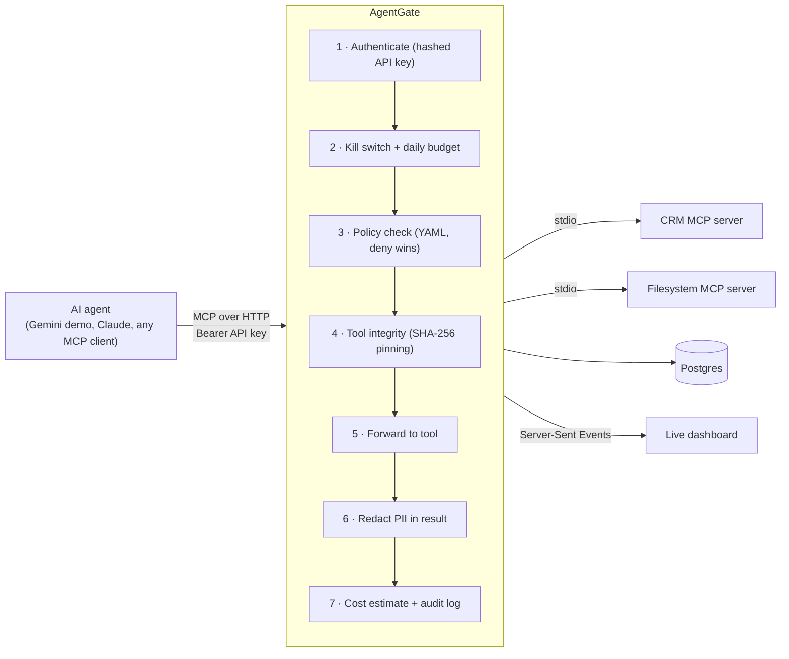

# 🛡️ AgentGate

**A security and governance gateway for AI agents using MCP (Model Context Protocol).**

Companies are connecting AI agents to their databases, files and internal tools through MCP — but MCP has no built-in permissions, data protection, audit trail or cost control. That is why most agent pilots never get past the security review.

AgentGate sits between agents and tools. Every tool call is **authenticated, authorised, checked for tampering, redacted, costed and logged** — with a live dashboard on top.



## What it does

| Problem enterprises have | What AgentGate does |
|---|---|
| Any agent can call any tool | **Per-team policies** in YAML with glob patterns. Deny overrides allow; anything not allowed is denied. Hot-reloads on save. |
| Personal data flows to LLM providers | **PII redaction** of tool results: emails, AU phone numbers, credit cards (Luhn-checked), TFNs and Medicare numbers (checksum-validated to avoid false positives). |
| Tool servers can be silently modified ("rug pull") | **Tool pinning**: every tool definition is fingerprinted. A changed definition is quarantined, hidden from agents and raised as an alert until an admin re-approves it. |
| No record of what agents did | **Audit log** of every call (allowed, blocked or failed) with agent, team, redacted arguments, reason and latency. |
| Surprise AI bills | **Cost attribution** per team (tool-result tokens + LLM usage reported by agents) with **daily budgets** that block calls when exceeded. |
| No way to stop a misbehaving agent | **Kill switch**: pause any agent from the dashboard; all its calls are blocked instantly. |
| Agents silently get worse | **Eval suite** (security + end-to-end agent cases) that runs in **GitHub Actions** and fails the build below 100%. |

## Demo

> 🎥 _Add your 90-second demo video link here._

```bash
npm run agent -- --as marketing "How many customers do we have in Victoria?"   # ✅ allowed, phones/emails masked
npm run agent -- --as marketing "What is the CEO's salary?"                     # ⛔ blocked by policy
npm run agent -- --as hr "What is the CEO's salary?"                            # ✅ HR is allowed
npm run agent -- --as intruder "List customers"                                 # ⛔ invalid API key
npm run tamper                                                                  # 🚨 tool quarantined within ~10s
```

## Run it locally

Requirements: Node 20+, Docker Desktop, Python 3.10+ (evals only), a free [Gemini API key](https://aistudio.google.com/apikey) (demo agent only).

```bash
npm install
cp .env.example .env            # then add GEMINI_API_KEY
npm run db:up                   # Postgres in Docker
npm run db:push && npm run db:seed
npm run dev:gateway             # http://localhost:4000 (dashboard) and /mcp (agents)
```

In a second terminal:

```bash
npm test                        # unit tests: PII detectors + policy engine
npm run evals                   # security evals against the running gateway
npm run evals -- --agent        # + end-to-end cases with the Gemini agent
```

## Project structure

```
apps/gateway/        MCP proxy, security pipeline, REST + SSE API, dashboard (public/)
apps/demo-agent/     Gemini agent that reaches tools only through AgentGate
upstreams/crm-mcp/   Demo CRM MCP server with fake customer + salary data
packages/db/         Prisma schema and seed (teams, agents, audit, pins, alerts, usage)
policies/            Access policies (YAML)
evals/               Eval cases + stdlib-only Python runner
```

## Design decisions

- **Stateless Streamable HTTP**: a fresh MCP server per request, so the gateway can scale horizontally behind a load balancer.
- **Tool namespacing** (`crm__query_customers`) avoids collisions between upstream servers.
- **Default deny** policy model; deny rules always win.
- **API keys are stored as SHA-256 hashes**, never in plain text.
- **Checksum validation** (Luhn, TFN, Medicare) cuts PII false positives on ordinary numbers.
- **Quarantined tools are removed from `tools/list`**, so the model never even reads a tampered description.

## Limitations and roadmap

This is a v0.1 portfolio project, not a hardened product.

- Identity is per-agent API key → roadmap: OIDC/SSO and per-user delegation
- Regex/checksum PII detection → roadmap: ML-based detection (e.g. Presidio), names and addresses
- Tool-result cost is an estimate (~4 chars/token) → roadmap: LLM-provider proxy for exact accounting
- Roadmap: human-in-the-loop approval for risky tools, OpenTelemetry export, Helm chart

## Tech

TypeScript · Node.js · Express · MCP TypeScript SDK · Prisma · Postgres · Docker · Gemini API · Python · GitHub Actions

---

Built by Hitesh Beniwal. See [SPEC.md](SPEC.md) for the full specification.
